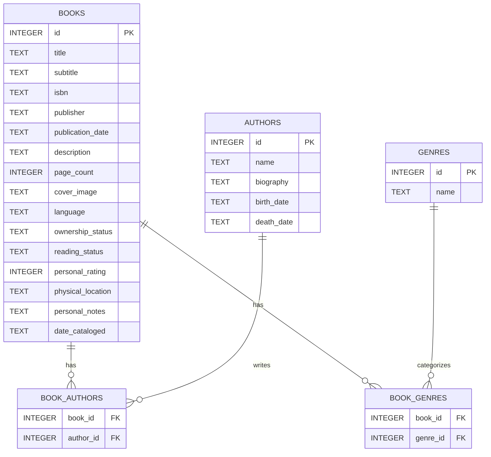

# Developer Documentation: Home Library (Book Management System)

This document provides the technical design, database architecture, form specifications, workflows, library recommendations, and API integration details for implementing the **Home Library** application using **React Native + Expo**.

---

## 1. Technical Stack & Recommended Libraries

The application is built as a fully offline-first mobile app for Android, leveraging the React Native and Expo ecosystems.

| Category | Recommended Library | Purpose |
| :--- | :--- | :--- |
| **Framework** | [Expo](https://expo.dev/) | Cross-platform framework, environment management, and native wrappers. |
| **Routing** | [Expo Router](https://docs.expo.dev/router/introduction/) | File-based navigation, supporting deep linking and standard native transition patterns. |
| **Database** | [expo-sqlite](https://docs.expo.dev/versions/latest/sdk/sqlite/) | Durable, native SQLite database that prevents data loss from browser cache eviction. |
| **ORM / Query Builder** | [Drizzle ORM](https://orm.drizzle.team/docs/get-started-sqlite) | Type-safe query building and automated schema migration management. |
| **Camera & Barcode** | [expo-camera](https://docs.expo.dev/versions/latest/sdk/camera/) | High-performance access to the rear camera with built-in barcode scanner detection. |
| **Haptics** | [expo-haptics](https://docs.expo.dev/versions/latest/sdk/haptics/) | Haptic feedback for barcode scanner success and save confirmation. |
| **Bottom Drawers** | [@gorhom/bottom-sheet](https://ui.gorhom.dev/) | Performance-optimized native-feeling bottom sheets for selectors and dialogs. |
| **File Sharing** | [expo-sharing](https://docs.expo.dev/versions/latest/sdk/sharing/) | Sharing JSON backup files using Android's native Share Sheet. |
| **File Selection** | [expo-document-picker](https://docs.expo.dev/versions/latest/sdk/document-picker/) | Choosing local backup JSON files for restore operations. |
| **File System** | [expo-file-system](https://docs.expo.dev/versions/latest/sdk/file-system/) | Saving temporary backup files and caching cover images. |
| **Styling** | [NativeWind](https://www.nativewind.dev/) | CSS-in-JS utility styling utilizing Tailwind CSS patterns. |

---

## 2. Database Architecture (Local SQLite)

To ensure **100% offline data integrity**, the app uses a local SQLite database. Below is the relational schema designed to support books, authors, and genres.

### Entity Relationship Diagram (Conceptual)


### Database Tables & Schema DDL

```sql
-- 1. Authors Table
CREATE TABLE authors (
    id INTEGER PRIMARY KEY AUTOINCREMENT,
    name TEXT NOT NULL,
    biography TEXT,
    birth_date TEXT, -- ISO 8601 (YYYY-MM-DD) or Year (YYYY)
    death_date TEXT  -- ISO 8601 or Year (null if alive)
);

-- 2. Genres Table
CREATE TABLE genres (
    id INTEGER PRIMARY KEY AUTOINCREMENT,
    name TEXT NOT NULL UNIQUE
);

-- 3. Books Table
CREATE TABLE books (
    id INTEGER PRIMARY KEY AUTOINCREMENT,
    title TEXT NOT NULL,
    subtitle TEXT,
    isbn TEXT,                      -- Supports ISBN-10 or ISBN-13
    publisher TEXT,
    publication_date TEXT,          -- ISO 8601 or Year
    description TEXT,
    page_count INTEGER,
    cover_image TEXT,               -- URI pointing to local disk or remote source
    language TEXT,                  -- Language code (e.g., 'pl', 'en')
    ownership_status TEXT NOT NULL, -- Enum: 'OWNED', 'WISHLIST'
    reading_status TEXT NOT NULL,   -- Enum: 'TO_READ', 'READING', 'COMPLETED', 'PAUSED'
    personal_rating INTEGER,        -- 1 to 5 stars (null if unrated)
    physical_location TEXT,         -- Shelf location description
    personal_notes TEXT,
    date_cataloged TEXT NOT NULL    -- ISO 8601 Timestamp when added
);

-- 4. Book Authors Junction Table (Many-to-Many Relationship)
CREATE TABLE book_authors (
    book_id INTEGER NOT NULL,
    author_id INTEGER NOT NULL,
    PRIMARY KEY (book_id, author_id),
    FOREIGN KEY (book_id) REFERENCES books (id) ON DELETE CASCADE,
    FOREIGN KEY (author_id) REFERENCES authors (id) ON DELETE CASCADE
);

-- 5. Book Genres Junction Table (Many-to-Many Relationship)
CREATE TABLE book_genres (
    book_id INTEGER NOT NULL,
    genre_id INTEGER NOT NULL,
    PRIMARY KEY (book_id, genre_id),
    FOREIGN KEY (book_id) REFERENCES books (id) ON DELETE CASCADE,
    FOREIGN KEY (genre_id) REFERENCES genres (id) ON DELETE CASCADE
);
```

### Core Database Indexes
To maintain responsive query times with large libraries, the following indexes are required:
```sql
CREATE INDEX idx_books_isbn ON books(isbn);
CREATE INDEX idx_books_title ON books(title);
CREATE UNIQUE INDEX idx_genres_name ON genres(name);
CREATE INDEX idx_authors_name ON authors(name);
```

---

## 3. Forms & Fields Specification

### A. Book Form (Add / Edit Screen)
This form handles both manual data entry and pre-filling.

| Field | Type | Input Method | Validation Rules |
| :--- | :--- | :--- | :--- |
| **ISBN (Prefill)** | String | Number pad keyboard + Camera trigger | Max 13 chars. Only numbers. |
| **Title** | String | Standard Keyboard | Required. Max 255 characters. |
| **Subtitle** | String | Standard Keyboard | Optional. |
| **Authors** | Array[ID] | Multi-select overlay (Bottom Drawer) | Must contain at least one Author. |
| **Genres** | Array[ID] | Multi-select chips (Bottom Drawer) | Optional. |
| **Publisher** | String | Standard Keyboard | Optional. |
| **Publication Date**| String | Number pad / Date picker dialog | Optional. ISO format or Year. |
| **Description** | Text | Multi-line textarea | Optional. |
| **Page Count** | Integer | Numeric Keyboard | Optional. Positive integer. |
| **Cover Image** | URI | Path selection (automatic from lookup) | Local file path or fallback network URL. |
| **Language** | String | Dropdown / Search list | Max 10 chars (e.g., ISO standard 'pl', 'en'). |
| **Ownership** | Enum | Segmented Control (`Owned` \| `Wishlist`) | Required. Default: `Owned`. |
| **Reading Status** | Enum | Dropdown / Segmented picker | Required. Default: `To Read`. |
| **Rating** | Integer | Tap-to-select stars (1 - 5) | Optional (null allowed). |
| **Shelf/Location** | String | Standard Keyboard | Optional. |
| **Personal Notes** | Text | Multi-line textarea | Optional. |

### B. Author Quick-Add Modal
Triggered directly via the Add Book form without losing current form progress.

*   **Name** (Required, String): Text Input.
*   **Biography** (Optional, Text): Multi-line Text Area.
*   **Birth Date** (Optional, String): Input field (numeric/year).
*   **Death Date** (Optional, String): Input field (numeric/year).

### C. Genre Custom Tag Input
Inline text input positioned directly inside the Genre picker drawer. Typing a new tag and pressing "Enter" or "Add" triggers a database check, creates the tag in the background if it is missing, and automatically selects it.

---

## 4. Key Application Workflows

### 1. Manual Form & ISBN Prefill

```
[User enters Add Book Form] 
       │
       ├──► [Type ISBN or scan via Camera drawer]
       │
       └──► [Tap "Download Info"]
                 │
                 ├──► Perform Lookup chain (Polish e-ISBN -> Open Library)
                 │
                 ├───► [Success] ──► Auto-populate form fields, download cover to cache
                 │
                 └───► [Fail] ─────► Visual error notification (e.g., "ISBN not found. Please fill manually.")
```

#### Detailed Transactional Steps for Saving:
1. Wrap the entire save action in a SQLite database transaction.
2. For any **Authors** checked:
   * If new, insert into `authors` and retrieve the new ID.
   * If existing, use the existing ID.
3. For any **Genres** checked:
   * If new, insert into `genres` and retrieve the ID.
   * If existing, retrieve the ID.
4. Insert the record into `books`. Retrieve the new book ID.
5. Create rows in `book_authors` matching the book ID to author IDs.
6. Create rows in `book_genres` matching the book ID to genre IDs.
7. Commit the transaction. If any step fails, roll back to preserve library consistency.

---

### 2. Automatic Barcode Scan (Quick Add)

```
[Tap "Quick Scan" on bottom nav]
       │
       ├──► Open full screen Camera view with overlay guide
       │
       └──► Barcode Detected (ISBN-10/13)
                 │
                 ├──► Trigger subtle haptic feedback (Haptics.notificationAsync)
                 │
                 ├──► API Lookup Chain
                 │
                 ├───► [Found] ──► Automatically save book/authors/genres to SQLite
                 │                 └──► Redirect immediately to Book Details View
                 │
                 └───► [Not Found] ──► Trigger warning haptic / error message
                                       └──► Redirect to Book Form with ISBN prefilled
```

---

### 3. Backup & Restore (JSON Serialization)

> [!IMPORTANT]
> Because there is no cloud database synchronization, the Backup and Restore flow must be robust and run without errors.

#### Backup Process:
1. Fetch all records from `books`, `authors`, `genres`, `book_authors`, and `book_genres`.
2. Package them into a structured JSON payload:
   ```json
   {
     "version": 1,
     "exportedAt": "2026-07-12T22:28:00Z",
     "authors": [...],
     "genres": [...],
     "books": [...],
     "book_authors": [...],
     "book_genres": [...]
   }
   ```
3. Write the JSON payload string to a temporary file via `expo-file-system`.
4. Trigger `expo-sharing` on the temporary file, launching the Android Share Sheet.

#### Restore Process:
1. Open native file dialog using `expo-document-picker`.
2. Read the selected file content using `expo-file-system`.
3. Validate JSON format:
   * Verify version presence and root-level keys.
   * Run schema checks on individual records.
4. Prompt the user with a confirmation warning: *"Restoring will merge items into your library. Existing duplicate books will be skipped. Proceed?"*
5. Run a SQLite database transaction:
   * Iterate through the imported authors and upsert them (match by name or ID).
   * Iterate through genres and upsert them (match by name).
   * Insert books, skipping duplicates by ISBN (if an ISBN is present and already exists).
   * Re-link corresponding junction relationships using translated database IDs.
6. Trigger haptic success notification.

---

## 5. API Integration Details

The application implements a dual-lookup chain:

### Step 1: Query Polish e-ISBN API (Primary)
*   **Documentation Link:** [e-ISBN API Documentation](https://e-isbn.pl/IsbnWeb/start/Dokumentacja_API.pdf)
*   **Access Requirements:** Access credentials (Client ID/Token) may be required depending on e-ISBN policies. If public keys are unavailable, this service should default to safe error handling and immediately fall back to Step 2.
*   **Expected Request:**
    *   `GET` request containing the ISBN query query parameter.
*   **Primary Mapping Strategy:**
    *   Map Polish strings (e.g., *tytuł* -> `title`, *autor* -> `author`, *rok wydania* -> `publication_date`, *wydawca* -> `publisher`).

### Step 2: Query Open Library API (Fallback & Enrichment)
*   **Documentation Link:** [Open Library Developer API](https://openlibrary.org/developers/api)
*   **Access Requirements:** Free, public, no registration/keys required.
*   **Endpoint for ISBN Lookup:**
    `GET https://openlibrary.org/api/books?bibkeys=ISBN:{isbn}&jscmd=data&format=json`
*   **Example Response:**
    ```json
    {
      "ISBN:9780140328721": {
        "title": "Fantastic Mr. Fox",
        "subtitle": "A Children's Story",
        "publishers": [{"name": "Puffin"}],
        "publish_date": "1988",
        "number_of_pages": 96,
        "cover": {
          "small": "https://covers.openlibrary.org/b/id/8231856-S.jpg",
          "medium": "https://covers.openlibrary.org/b/id/8231856-M.jpg",
          "large": "https://covers.openlibrary.org/b/id/8231856-L.jpg"
        },
        "authors": [
          {
            "name": "Roald Dahl",
            "url": "https://openlibrary.org/authors/OL34184A/Roald_Dahl"
          }
        ]
      }
    }
    ```

#### Author Profile Enrichment Endpoint:
To retrieve birth dates, death dates, or biographic data for the author profile:
*   **Endpoint:**
    `GET https://openlibrary.org/authors/{author_key}.json`
    *(Extract the `author_key` from the book response URL, e.g., `OL34184A`)*
*   **Response Extract:**
    ```json
    {
      "name": "Roald Dahl",
      "bio": "Roald Dahl was a British novelist...",
      "birth_date": "13 September 1916",
      "death_date": "23 November 1990"
    }
    ```

> [!TIP]
> When downloading cover image URIs, it is recommended to cache the files locally using `expo-file-system` to ensure cover artwork loads instantly when the device is completely offline.

---

### Links to Reference Files
*   [application_description.md](file:///f:/Projects/HomeLib/application_description.md) - Core system requirements, mock UX structures, and rules.
